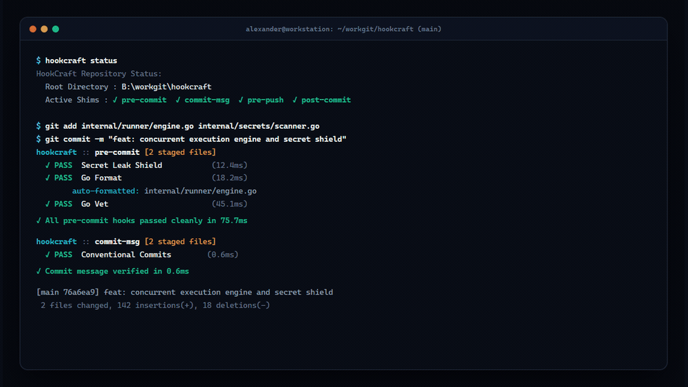
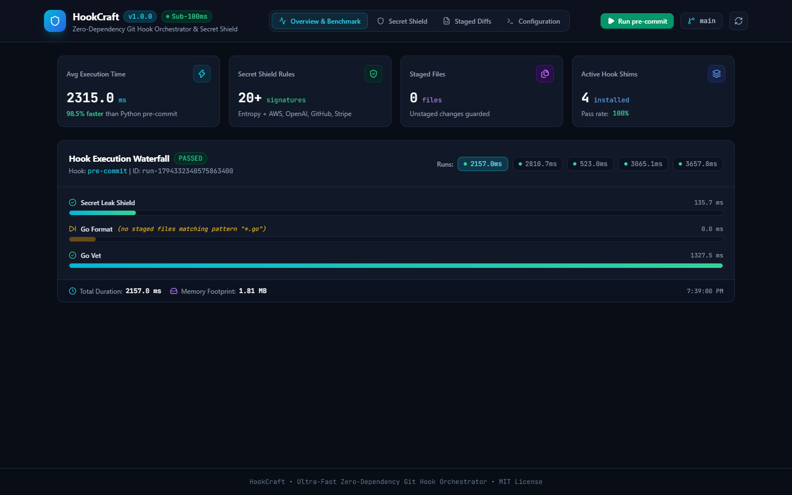
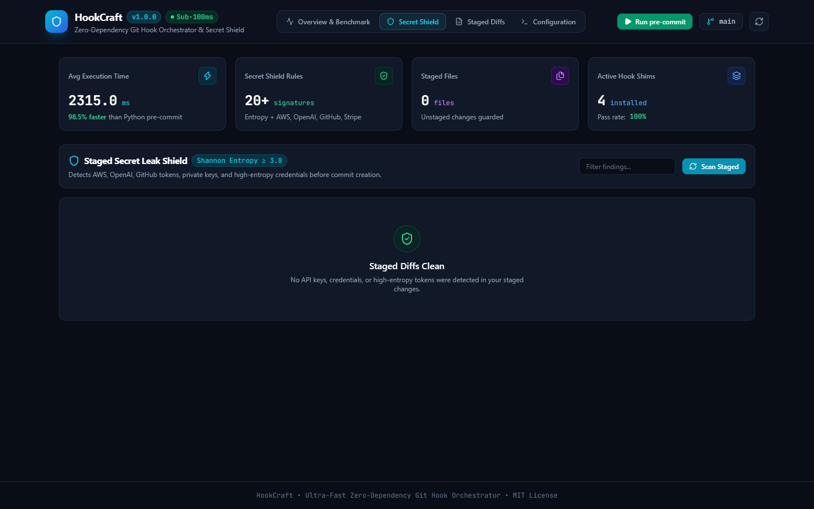
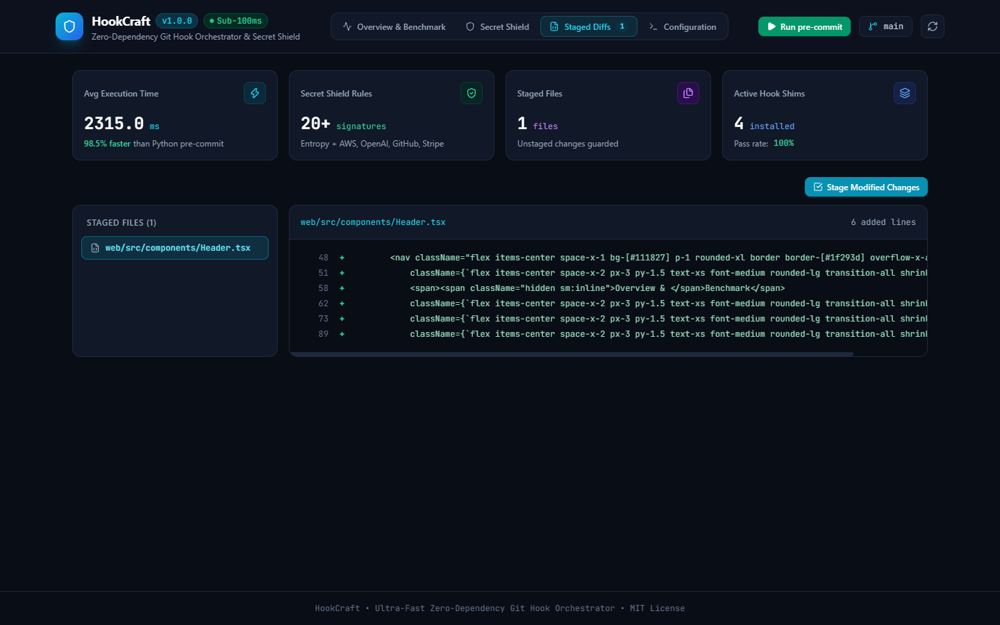
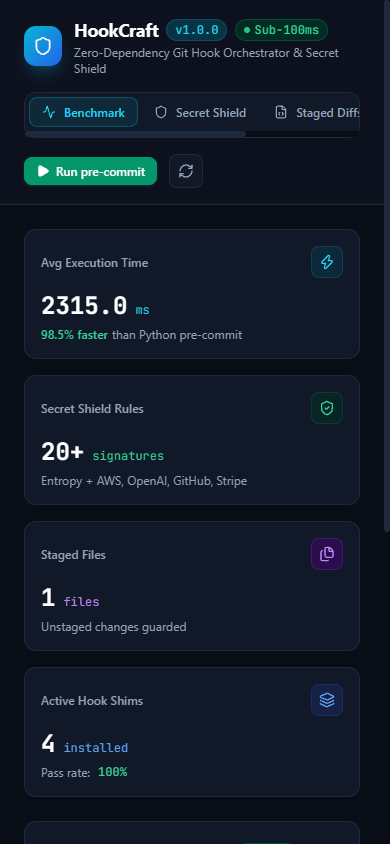
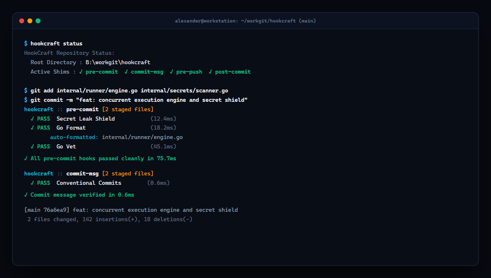

<p align="center">
  
</p>

<h1 align="center">HookCraft</h1>

<p align="center">
  <strong>Ultra-Fast Zero-Dependency Git Hook Orchestrator and Staged Secret Leak Shield in Go.</strong><br>
  A single native binary alternative to Husky, Python pre-commit, and Lefthook (&lt; 15MB RAM).
</p>

<p align="center">
  <a href="LICENSE"></a>
  <a href="https://go.dev/"></a>
  <a href="https://react.dev/"></a>
</p>

<p align="center">
  
</p>

---

## Overview

HookCraft solves common developer friction points associated with traditional Git hook runners:

- Zero runtime dependencies: Compiled as a standalone Go binary. It does not require Node.js, npm, or Python virtual environments.
- Fast concurrent execution: Runs linters and formatters concurrently across CPU cores in under 100 milliseconds, operating strictly on staged files (`git diff --staged`).
- Content-Addressable Cache: Computes SHA-256 signatures over step commands and staged file contents to skip clean steps with `⚡ CACHED (< 1ms)`.
- Built-in Secret Leak Shield: Evaluates staged diffs using pre-compiled signatures (AWS, GitHub, Stripe, OpenAI) and Shannon entropy heuristics to block committed credentials.
- Safe Stash Guard: Isolates unstaged working tree modifications during hook execution, preventing dirty code leaks and formatter merge conflicts.
- Large File and Branch Protection Shields: Built-in shields preventing accidental commits over 5MB or direct pushes to protected branches (`main`, `master`).
- Interactive Fix Approver: Automatically detects files modified by formatters (such as Prettier, Ruff, or `gofmt`) and provides 1-key approval (`[y/n/d]`) or automatic re-staging.
- Instant Migration Engine: Converts `.pre-commit-config.yaml` (Python), `lefthook.yml`, and `.husky/` setups into a native `.hookcraft.yaml` via `hookcraft migrate`.
- Embedded Studio: Includes a React 19 web dashboard served directly from the executable for execution waterfalls and secret audit inspection.

---

## Installation

### From Precompiled Releases (Recommended)

Download the binary for your platform from GitHub Releases, make it executable, and place it in your system PATH:

```bash
# Example for Linux/macOS
curl -fsSL https://github.com/alexandrmotologa/hookcraft/releases/latest/download/hookcraft-linux-amd64 -o hookcraft
chmod +x hookcraft
sudo mv hookcraft /usr/local/bin/
```

### From Source Using Go

```bash
go install github.com/alexandrmotologa/hookcraft/cmd/hookcraft@latest
```

---

## Quick Start

### 1. Initialize Configuration

Run `hookcraft init` inside any Git repository. HookCraft inspects the project files and generates a tailored `.hookcraft.yaml`:

```bash
hookcraft init
```

### 2. Install Git Hook Shims

Install POSIX shims into `.git/hooks/` with a single command:

```bash
hookcraft install
```

This installs shims for `pre-commit`, `commit-msg`, `pre-push`, and `post-commit`. If existing non-HookCraft hooks exist, HookCraft saves them with a `.hookcraft-backup` suffix.

### 3. Commit As Usual

Whenever you run `git commit`, HookCraft runs automatically:

```
hookcraft :: pre-commit [2 staged files]
  ✓ PASS  Secret Leak Shield           (12.4ms)
  ✓ PASS  Go Format                    (18.2ms)
        auto-formatted: internal/git/staged.go
  ✓ PASS  Go Vet                       (45.1ms)

✓ All hooks passed cleanly in 75.7ms
```

---

## Configuration Reference (`.hookcraft.yaml`)

```yaml
version: 1

settings:
  concurrency: true           # Run independent hooks in parallel across CPU cores
  auto_stage_fixes: true      # Automatically re-stage files modified by formatters
  interactive_approval: false # Set true to show diff and prompt [y/N] before staging
  block_secret_leaks: true    # Block commits containing API keys or high-entropy tokens
  entropy_threshold: 3.8      # Shannon entropy threshold for secret detection
  timeout_seconds: 30         # Default process timeout
  stash_unstaged: true        # Stash unstaged modifications during hook runs
  fail_fast: false            # Stop execution immediately upon first failure

hooks:
  pre-commit:
    - name: "Secret Leak Shield"
      type: "builtin:secret_shield"
      action: "block"

    - name: "Go Format"
      glob: "*.go"
      run: "gofmt -w {staged_files}"
      stage_fixed: true

    - name: "Go Vet"
      glob: "*.go"
      run: "go vet ./..."

  commit-msg:
    - name: "Conventional Commits"
      type: "builtin:conventional_commits"

  pre-push:
    - name: "Go Tests"
      run: "go test -short ./..."
```

See [docs/CONFIGURATION.md](docs/CONFIGURATION.md) for full options and language recipes (TypeScript, Python, Rust).

---

## Secret Leak Shield

HookCraft intercepts credential leaks before commits are created. It scans added lines in unified diff hunks (`git diff --staged -U0`) using two mechanisms:

1. Exact provider signatures: Detects AWS access keys (`AKIA...`), GitHub personal access tokens (`ghp_...`, `github_pat_...`), OpenAI API keys (`sk-...`), Stripe live keys, Slack tokens, Google Cloud keys, and private SSH/RSA headers.
2. Shannon entropy heuristics: Flags randomized strings exceeding the safety threshold (default 3.8 bits per byte).

### Inline Suppression

To deliberately commit test tokens, append an inline suppression comment to the line:

```go
const TestKey = "AKIA1234567890EXAMPLE" // hookcraft:ignore
```

See [docs/SECRET_SHIELD.md](docs/SECRET_SHIELD.md) for full detection specifications.

---

## HookCraft Studio

HookCraft includes an embedded web dashboard for inspecting execution performance waterfalls, historical commit timings, staged secret audits, and configuration state.

Launch the studio:

```bash
hookcraft studio --port 4173
```

Open `http://localhost:4173` in your browser. The dashboard is embedded directly into the Go binary (`//go:embed all:dist`) and requires no external Node.js or web server.

### Execution Performance Waterfall

Inspect step durations, worker concurrency, and memory consumption in real time:

<p align="center">
  
</p>

### Staged Secret Leak Shield and Diff Inspector

Review flagged tokens, line numbers, and colorized diff hunks:

<p align="center">
  
</p>

### Staged Diffs Browser and Multi-Device Responsiveness

Review staged code modifications and manage hooks across desktop, tablet, and mobile devices:

<p align="center">
  
  
</p>

### Terminal Execution

Run Git hooks directly in your command line with sub-100ms response times:

<p align="center">
  
</p>

---

## CLI Command Reference

| Command | Description |
| :--- | :--- |
| `hookcraft run [hook]` | Manually triggers a Git hook (`pre-commit`, `commit-msg`, `pre-push`). |
| `hookcraft install` | Installs lightweight shims into `.git/hooks/`. |
| `hookcraft uninstall` | Removes HookCraft shims and restores previous backups. |
| `hookcraft scan` | Runs the Secret Leak Shield on staged changes or repository files. |
| `hookcraft init` | Generates a tailored `.hookcraft.yaml` for the current repository. |
| `hookcraft migrate` | Automatically converts Husky, pre-commit, or Lefthook configs to HookCraft. |
| `hookcraft cache [clean]` | Displays cache directory information or clears cached step results. |
| `hookcraft status` | Displays active hook shims and repository state. |
| `hookcraft studio` | Launches the embedded React 19 web dashboard. |
| `hookcraft version` | Prints binary version and compilation date. |

---

## Documentation

- [docs/ARCHITECTURE.md](docs/ARCHITECTURE.md): Detailed internals, Git plumbing, concurrency pipeline, and stash safety.
- [docs/CONFIGURATION.md](docs/CONFIGURATION.md): Complete configuration schema, glob patterns, and language recipes.
- [docs/SECRET_SHIELD.md](docs/SECRET_SHIELD.md): Entropy calculations, pattern signatures, and suppression rules.

---

## License

MIT License. See [LICENSE](LICENSE) for details.
